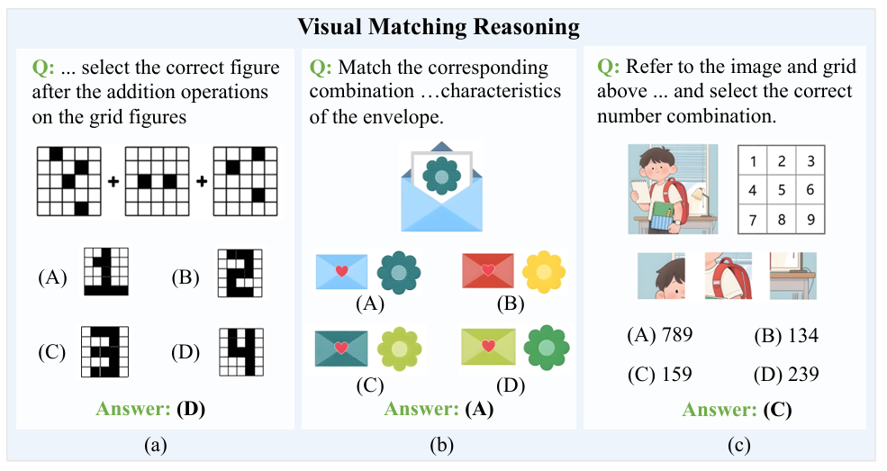
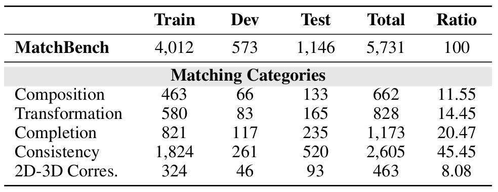
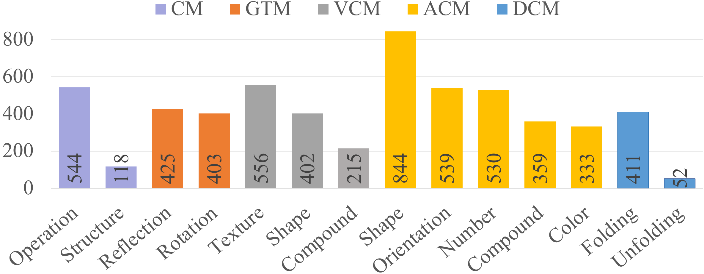

<br />
<p align="center">
  <h1 align="center"> 🧩MatchBench: Benchmarking Visual Matching Reasoning in Multimodal Large
Language Models</h1>
  <h3 align="center">MatchBench: A new benchmark dataset for visual matching reasoning of MLLMs.</h3>
  
  <p align="center">  
    ·
    <a href="https://github.com/Zigrek498/MatchBench/blob/main/data/all.jsonl">github</a>
    ·
    <a href="https://github.com/Zigrek498/MatchBench/blob/main/LICENSE">license</a>
    
  </p>
</p>


## Contents

- [Contents](#contents)
- [1 Overview](#1-overview)
  - [Examples](#examples)
  - [Detail Information](#detail-information)
  - [Dataset classification](#dataset-classification)
- [2 Access MatchBench](#2-access-matchbench)
  - [Download dataset](#download-dataset)
  - [Data Format](#data-format)
- [3 Experiment and Evaluation](#3-experiment-and-evaluation)
  - [Experiment](#experiment)
    - [Inference](#inference)
    - [Finetune](#finetune)
  - [Evaluation](#evaluation)
  - [Requirements](#requirements)
- [4 License](#4-license)


## 1 Overview
**MatchBench** is a **manually annotated** dataset designed for **multimodal visual matching reasoning** in a multiple‑choice question & answer format.
The dataset includes 5,731 samples collected from educational platforms, social media and generative‑AI sources, covering 14 fine‑grained matching types under five major categories, without relying on bounding boxes. To address the limitations of existing datasets, we define rigorous annotation pipelines for MatchBench, including constructing error‑driven distractor options and filtering samples solvable merely from textual cues alone, and conduct multi‑round human review and verification to guarantee dataset quality.

### Examples
The following figures compare sample data from our MatchBench with existing visual‑matching reasoning benchmarks. “Q” and “A” denote the question and answer, respectively.


### Detail Information

As detailed in the following table, MatchBench contains 5,731 samples, split into training, development, and test sets with a 7:1:2 ratio. We also ensured proper distribution across its five major matching categories and 14 fine‑grained sub‑categories, following the real‑world prevalence of matching tasks seen in educational materials.
  
All the split data sets are in the directory ***(data/)***.
  

*Note: To make directory paths easier to find, they are formatted in **bold and italics**. This is because direct links to directories may not work in some environments. Thank you!*
The following table lists the detailed information statistics of the split dataset.


### Dataset classification

We manually classified the raw data into hierarchical categories. The dataset is organized under five top‑level matching categories: Compositional Matching, Geometric Transformation Matching, Visual Completion Matching, Attribute Consistency Matching, and 2D‑3D Correspondence Matching, which are further divided into 14 fine‑grained sub‑types. Sample volume varies across sub‑categories, ranging from 52 to 844 instances. This uneven distribution mirrors the frequency of different reasoning tasks within real‑world educational resources. The following chart shows the detailed classification of our dataset.


## 2 Access MatchBench
### Download dataset

Our dataset has been officially released on the Github. It is available at [MatchBench](https://anonymous.4open.science/r/MatchBench-4EB7). The original images are saved in the **_(data/img)_** directory, and the annotated data are saved in the **_(data/*.jsonl)_** files.


### Data Format
Each `JSONL` file is of the following format:
```json
{"id": 1, "image": "Transformation-Reflection-00001.jpg", "question": "Choose the option that shows the original image mirrored.", "answer": "A"}
{"id": 1000, "image": "Gap-Completion-Compound-00172.jpg", "question": "Select the matching other half based on the color, shape, and texture of the original image to form a complete figure.", "answer": "B"}
{"id": 2000, "image": "Consistency-Compound-00016.jpg", "question": "Select the figure that matches all the attributes of the picture in the question for matching.", "answer": "B"}
{"..."}
```
Each line is an individual data point.The meaning of each field is as follows:

- `id`: The unique id.

- `image`: The filename of the image, which is consistent with the actual file.

- `question` : The manually annotated question.

-  `answer` : The correct answer to the question.

  <br>

## 3 Experiment and Evaluation

We provide the inference and fine-tuning code used in our experiments, along with a set of evaluation scripts, organized in the following directory structure.

```bash
Code/
├── close_models/      # Inference code for closed-source models
├── evaluation/        # Evaluation code for all inference results
├── open_models/       # Inference and fine-tune code for open-source models
└── requirements/      # Environment requirements for inference and finetuning
```

### Experiment
#### Inference
- For all 12 open-sourse MLLMs, you can directly execute Python files in the directory **_(code/open_models/inference)_** to perform inference on models before and after fine-tuning: 
```
python deepseek.py
python intern_8b.py
...
```
Due to the large amount of open source model code, you need to download it yourself through channels or call it directly from platforms such as [huggingface](https://huggingface.co).

- For gemini-3.8-flash and gpt-6-astra, you can directly execute our Python file in the directory **_(code/close_models)_** to perform inferencing of the zero-shot, few-shot and text-only, provided that you prepare a key:
```
python gemini.py
python gpt.py
```
Gemini needs to apply on the [official website](https://aistudio.google.com/app/apikey), and GPT needs to be purchased on the [official website](https://openai.com/).


#### Finetune
- For all the open-sourse MLLMs, you can directly execute bash files in the directory **_(code/finetune)_** to perform fine-tuning: 
```
bash deepseek.sh
bash intern_8b.sh
...
```

### Evaluation
You can process the results of model inference through the code we provide to calculate overall accuracy, overall P, R, F1 indicators, accuracy based on categories, and accuracy based on choices. We integrate the calculation process into the Python files in the directory **_(code/evaluation)_**:
```
python metrics.py
```

### Requirements
The environment configuration required for debugging code is placed in directory **_(code/requirements)_**

## 4 License
This project is licensed under the [Apache-2.0 License](LICENSE).